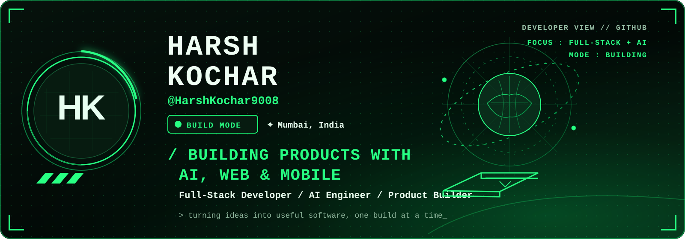

  

   

  
  
  
  

---

`TELEMETRY`　│　**FOCUS:** FULL-STACK　│　**AI:** LLMs & AGENTS　│　**MOBILE:** FLUTTER　│　**WEB3:** SMART CONTRACTS

## `// SYSTEM PROFILE`

I'm a software developer from **Mumbai, India**, working across frontend engineering, API integrations and AI-powered product development. I enjoy taking ideas from an early prototype to a polished, useful product.

My approach is simple: understand the problem, keep the experience intuitive, and build the engineering behind it to be reliable.

| `CORE SYSTEMS` | `CURRENT TOOLKIT` |
|:--|:--|
| **Full-stack engineering** | React · Next.js · TypeScript · Node.js · Django |
| **AI & intelligent apps** | LLM APIs · RAG · LangChain · Gemini · Groq |
| **Mobile development** | Flutter · Dart |
| **Web3 experiments** | Solidity · Ethereum · Solana · Hedera |
| **Data & infrastructure** | PostgreSQL · MongoDB · Redis · Firebase · Docker |

## `// SELECTED PROJECTS`

<table>
  <tr>
    <td width="50%" valign="top">
      <h3>🧠 <a href="https://github.com/HarshKochar9008/KaashAI">KaashAI</a></h3>
      AI-powered exam content generation and evaluation, with queued background workflows.
        
      Next.js · Express · MongoDB · Redis · BullMQ · Groq
        
      <a href="https://kaashai.vercel.app">↗ Live demo</a>
    </td>
    <td width="50%" valign="top">
      <h3>🛡️ <a href="https://github.com/HarshKochar9008/Trusty">Trusty</a></h3>
      Health-record verification concept combining AI-assisted checks with verifiable records on Hedera.
        
      TypeScript · AI APIs · Hedera
        
      <a href="https://trusty-ivory.vercel.app">↗ Live demo</a>
    </td>
  </tr>
  <tr>
    <td width="50%" valign="top">
      <h3>⚡ <a href="https://github.com/HarshKochar9008/ApexFlow_token">ApexFlow</a></h3>
      Solana dApp experiment with wallet sign-in and an integrated AI chat experience.
        
      React · TypeScript · Solana · Privy
        
      <a href="https://apexflowagent.com">↗ Live site</a>
    </td>
    <td width="50%" valign="top">
      <h3>💸 <a href="https://github.com/HarshKochar9008/finpilot">FinPilot AI</a></h3>
      Personal-finance assistant for tracking income and expenses and exploring AI-generated savings insights.
        
      TypeScript · Python · Gemini
    </td>
  </tr>
  <tr>
    <td width="50%" valign="top">
      <h3>📅 <a href="https://github.com/HarshKochar9008/WINCE">WINCE</a></h3>
      Session-booking platform with authentication and a full-stack web architecture.
        
      Django REST · React · PostgreSQL · Docker
        
      <a href="https://wince.vercel.app">↗ Live demo</a>
    </td>
    <td width="50%" valign="top">
      <h3>🧩 <a href="https://github.com/HarshKochar9008/MCP-PUCHAI">MCP-PUCHAI</a></h3>
      MCP server experiment for URL fetching, HTML-to-Markdown conversion and PDF résumé parsing.
        
      Python · MCP
    </td>
  </tr>
</table>

## `// TECHNOLOGY MATRIX`

**LANGUAGES**

**FRONTEND & MOBILE**

**BACKEND, DATA & AI**

**TOOLS & PLATFORMS**

## `// GITHUB ACTIVITY`

  
  

  

---

**HAVE AN IDEA? LET'S BUILD SOMETHING USEFUL.**

[Portfolio](https://harshkochar.tech)　·　[LinkedIn](https://www.linkedin.com/in/connectharsh1/)　·　[Email](mailto:harshkochar88@gmail.com)

`STAY CURIOUS. BUILD RELENTLESSLY.`

